<div align="center">

# 🚲 Bikepath

**Fahrradrouten planen, navigieren und Fahrten aufzeichnen – direkt im Browser, auf Android und iPhone.**

Kostenlos · ohne App Store · ohne Anmeldung · auch offline

### 👉 [jonnycamaro.github.io/bikepath](https://jonnycamaro.github.io/bikepath/)

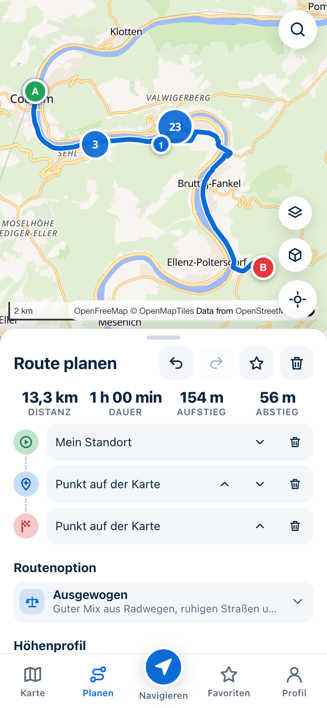&nbsp;&nbsp;
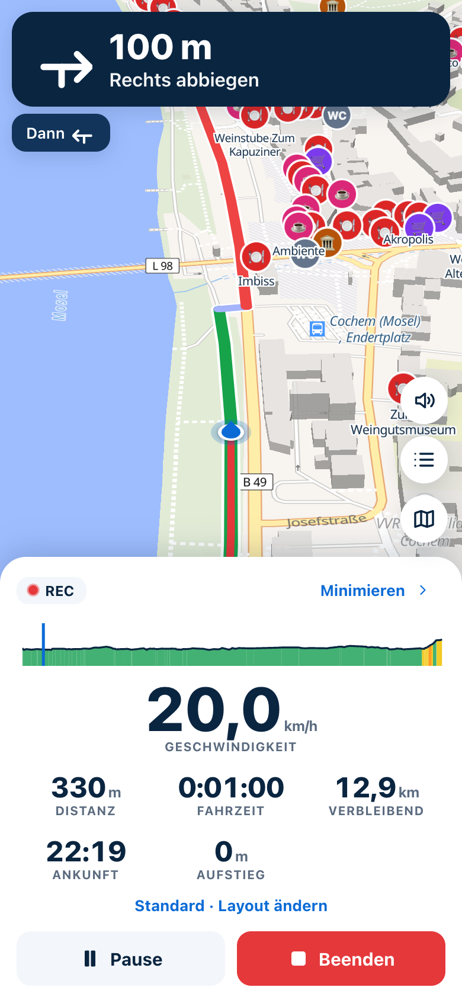&nbsp;&nbsp;
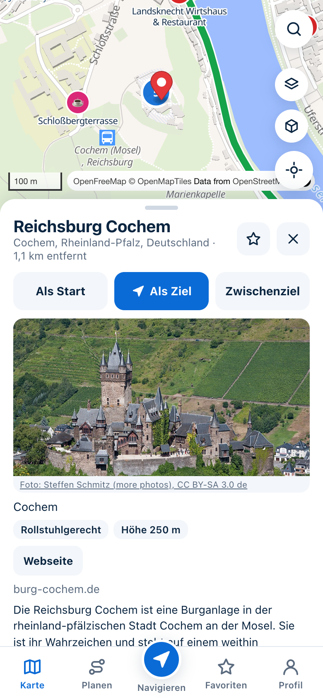

</div>

---

## Inhalt

- [Was kann Bikepath?](#was-kann-bikepath)
- [Installieren in 1 Minute](#installieren-in-1-minute)
- [So funktioniert's](#so-funktionierts)
  - [Die Karte](#die-karte)
  - [Eine Route planen](#eine-route-planen)
  - [Eine Rundtour planen](#eine-rundtour-planen)
  - [Navigieren](#navigieren)
  - [Fahrten aufzeichnen](#fahrten-aufzeichnen)
  - [Favoriten](#favoriten)
  - [Ohne Netz unterwegs](#ohne-netz-unterwegs)
  - [Eigene Routenoptionen](#eigene-routenoptionen)
- [Häufige Fragen](#häufige-fragen)
- [Daten und Datenschutz](#daten-und-datenschutz)

---

## Was kann Bikepath?

| | |
|---|---|
| 🗺️ **Karte** | Fahrradfreundliche Karten, Radkarte, Topo und Satellit, 3D-Gelände, Orte wie Cafés, Trinkwasser oder Radläden |
| 🧭 **Planen** | Strecke von A nach B mit Zwischenzielen oder Rundtour nach Kilometern oder Fahrzeit |
| 🚴 **Routenoptionen** | Ausgewogen, Radwege, Rennrad, Gravel, Mountainbike, E-Bike und mehr – oder ganz eigene |
| ⛰️ **Höhenprofil** | Steigungen, Untergrund und Wegtyp der Strecke, farbig auf der Karte |
| 🔊 **Navigation** | Abbiegehinweise mit Sprachansagen, Neuberechnung beim Verfahren, Fahrradcomputer |
| ⏺️ **Aufzeichnen** | Fahrten mit Distanz, Zeit, Tempo und Höhenmetern speichern |
| ⭐ **Favoriten** | Routen, Fahrten und Orte in Gruppen und Untergruppen sammeln |
| 📴 **Offline** | Karte entlang einer Route speichern und ohne Netz fahren |
| ℹ️ **Ortsinfos** | Öffnungszeiten („jetzt geöffnet“), Adresse, Telefon, Webseite, bei Sehenswürdigkeiten Text und Foto |
| 📤 **GPX/KML** | Routen als Datei teilen oder aus anderen Apps importieren |

---

## Installieren in 1 Minute

Bikepath ist eine **Web-App**: Sie läuft im Browser und lässt sich wie eine normale App auf den Startbildschirm legen. Es gibt nichts herunterzuladen und keine Anmeldung.

### Android (Chrome)

1. **[jonnycamaro.github.io/bikepath](https://jonnycamaro.github.io/bikepath/)** in Chrome öffnen.
2. Oben rechts auf **⋮** tippen → **„App installieren“** (oder „Zum Startbildschirm hinzufügen“).
3. Bikepath startet ab jetzt über das eigene Symbol, im Vollbild wie eine App.

### iPhone (Safari)

1. **[jonnycamaro.github.io/bikepath](https://jonnycamaro.github.io/bikepath/)** in **Safari** öffnen.
2. Unten auf **Teilen** (Quadrat mit Pfeil) tippen → **„Zum Home-Bildschirm“**.
3. Bikepath über das neue Symbol starten.

### Beim ersten Start

Tippe auf **„Los geht's – Standort erlauben“** und erlaube den Standort. Ohne Standort funktioniert die App auch – dann aber ohne „Mein Standort“, Navigation und Aufzeichnung.

> 💡 **Updates kommen von selbst.** Gibt es eine neue Version, holt die App sie beim Öffnen. Am schnellsten geht es, wenn du die App einmal ganz schließt (in der App-Übersicht wegwischen) und neu öffnest.

---

## So funktioniert's

Unten gibt es fünf Bereiche: **Karte**, **Planen**, **Navigieren** (der große Knopf in der Mitte), **Favoriten** und **Profil**.

### Die Karte

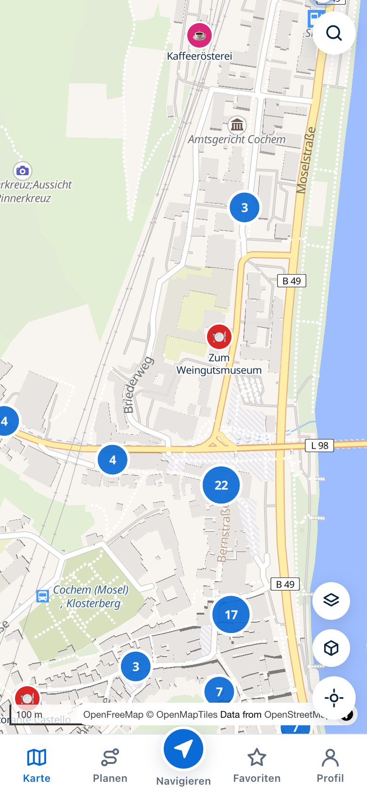

- **🔍 Suchen:** Lupe oben rechts. Ein Vorschlag springt direkt zum Ort. Drückst du stattdessen auf **Suchen/Enter**, erscheinen **alle Treffer** als rote Punkte auf der Karte, dazu eine Liste nach Entfernung.
- **📍 In die Karte tippen** öffnet einen kleinen Fächer an der Stelle (siehe [Route planen](#eine-route-planen)).
- **Kartenstil und Ebenen:** Knopf mit den Blättern rechts. Dort gibt es auch die Ebene **„POIs“** mit Orten wie Cafés, Restaurants, Supermärkten, Trinkwasser, WCs, Radläden oder Sehenswürdigkeiten – die Kategorien kannst du einzeln wählen.
- **Kreise mit Zahl** fassen nahe Orte zusammen. Ein Tipp zoomt hinein.
- **3D** (Würfel) zeigt das Gelände plastisch, **⊕** zentriert auf deinen Standort.

<br clear="right">

#### Infos zu einem Ort


Tippe auf einen Ort und dann im Fächer auf **ⓘ**. Unten erscheint eine Karte mit allem, was bekannt ist:

- **Öffnungszeiten** mit „Geöffnet · schließt um 21:00“ oder „öffnet morgen 07:00“ – inklusive Feiertagen
- Adresse, **Anrufen**, **Webseite**, Rollstuhl, WLAN, Küche …
- bei Sehenswürdigkeiten ein kurzer **Wikipedia-Text** und ein **Foto**
- Knöpfe **Google Maps** und **Tripadvisor** für Bewertungen
- **⭐** speichert den Ort als Favorit

<br clear="right">

### Eine Route planen

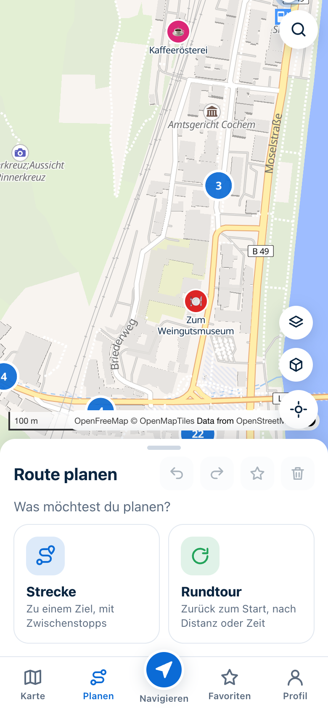&nbsp;
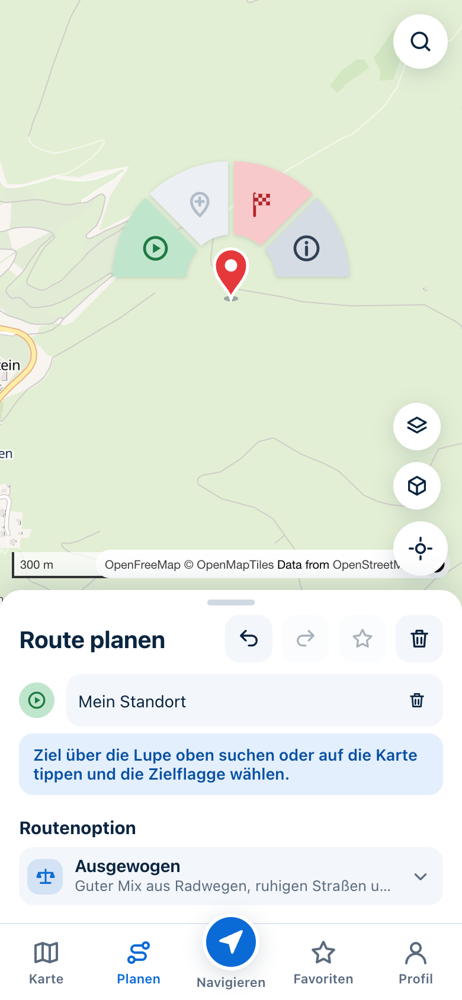&nbsp;


1. Tippe auf **Planen** (oder Navigieren) und wähle **Strecke**.
2. Dein **Standort ist automatisch der Start** (grünes Symbol).
3. **Tippe in die Karte** – über der Nadel öffnet sich ein Fächer:

   | Symbol | Bedeutung |
   |---|---|
   | ▶️ grün | **Als Start** |
   | 📍➕ blau | **Als Zwischenziel** (geht, sobald Start und Ziel stehen) |
   | 🏁 rot | **Als Ziel** |
   | ⓘ grau | **Infos** zum Ort |

   Ausgegraute Felder sind gerade nicht möglich. Alternativ suchst du Orte über die **Lupe** oben.
4. Die Route wird berechnet. Unten siehst du **Distanz, Dauer und Höhenmeter** und die **Punkteliste**:
   - Pfeile ändern die Reihenfolge, der Mülleimer entfernt einen Punkt.
   - Ein Tipp auf einen Punkt (in der Liste oder auf der Karte) zeigt ihn auf der Karte mit **ⓘ** und **🗑**.
   - Die **Routenlinie ziehen** fügt unterwegs einen Punkt ein.
5. Oben im Planer: **Rückgängig**, **Wiederholen**, **⭐ als Favorit speichern**, **🗑 Planung verwerfen**.
6. Unten: **Navigation starten** – daneben der kleine Knopf für den **GPX-Download**.

#### Routenoption und Höhenprofil

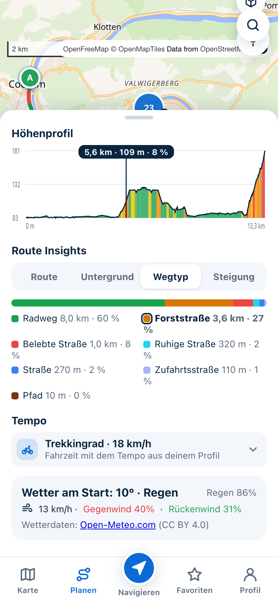

- Unter **Routenoption** wählst du, wie gerechnet wird: Ausgewogen, Schnellste, Radwege, Rennrad, Geschmeidig, Gravel, Mountainbike, E-Bike, Kürzeste – oder eine [eigene](#eigene-routenoptionen).
- **Höhenprofil:** Mit dem Finger darüberfahren zeigt die Stelle auf der Karte, mit Höhe und Steigung.
- **Route Insights:** Umschalten zwischen **Untergrund**, **Wegtyp** und **Steigung** färbt die Route auf der Karte entsprechend ein. Beim Abfahren des Höhenprofils wird der passende Eintrag **fett** hervorgehoben.
- Dazu: Fahrzeit nach deinem Tempo und das **Wetter am Start** mit Gegen- und Rückenwind.

<br clear="right">

### Eine Rundtour planen

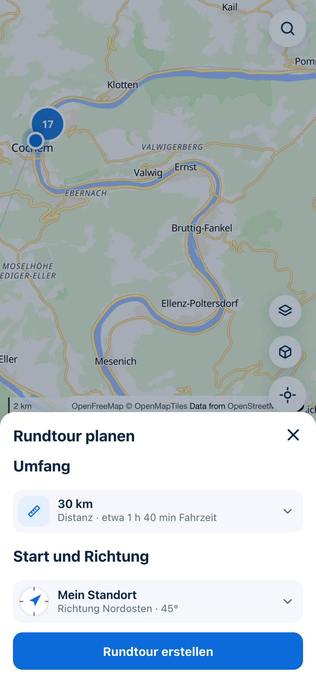&nbsp;
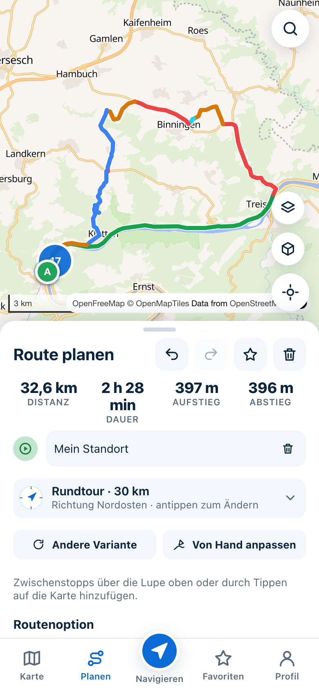

1. **Planen** → **Rundtour**.
2. **Umfang** wählen – als **Distanz** (z. B. 30 km) oder **Fahrzeit** (z. B. 1½ h).
3. **Start und Richtung** festlegen – auf einer Karte mit einem Richtungspfeil, den du drehen kannst.
4. **Rundtour erstellen.** Gefällt sie dir nicht: **Andere Variante**.
5. Zwischenstopps fügst du wie gewohnt per Tipp in die Karte hinzu – die Runde führt dann dort vorbei.

### Navigieren

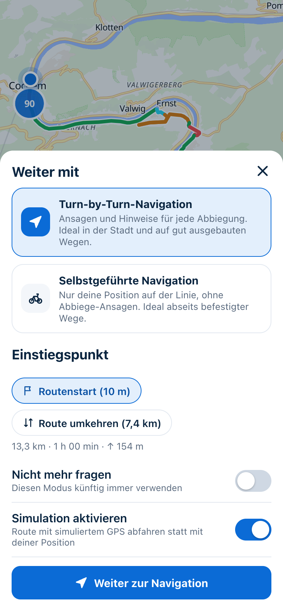&nbsp;


1. **Navigation starten** (im Planer oder bei einem Favoriten).
2. Wähle **Turn-by-Turn** (mit Ansagen für jede Abbiegung) oder **Selbstgeführt** (nur deine Position auf der Linie – gut abseits befestigter Wege).
3. **Einstiegspunkt:** am Start, am nächsten Punkt der Route oder Route umkehren.
4. Unterwegs: Abbiegehinweis oben, **Fahrradcomputer** unten (Tempo, Distanz, Zeit, Ankunft …). Ein langer Druck auf ein Feld ändert es.
5. **Vom Weg abgekommen?** Bikepath berechnet automatisch neu.

> 🧪 **Ausprobieren ohne Fahrrad:** Im Startdialog **„Simulation aktivieren“** einschalten – dann fährt die App die Route virtuell ab.

> ⚠️ Lass die App während der Fahrt **im Vordergrund**. Das Display bleibt dafür an. Wird Bikepath in den Hintergrund gedrängt, kann das Handy sie pausieren – das ist bei allen Web-Apps so.

### Fahrten aufzeichnen

- **Navigieren** → **„Nur aufzeichnen“** zeichnet eine freie Fahrt auf, auch ohne Route.
- **Auto-Pause** hält die Zeit an, wenn du stehst.
- Beim **Beenden** fragt Bikepath, ob die Fahrt gespeichert werden soll – mit Name und Gruppe in den Favoriten. Sonst wird sie verworfen.

### Favoriten

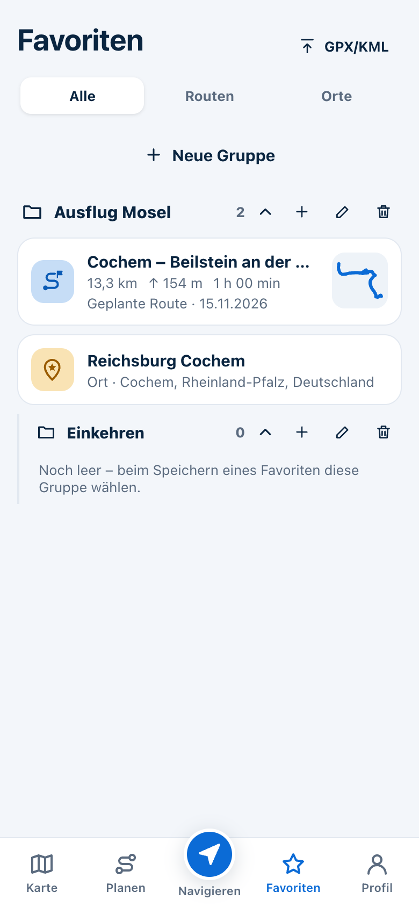

Hier liegt alles, was du gespeichert hast:

| Symbol | Was |
|---|---|
| 🟦 Linie mit Fähnchen | **geplante Route** |
| 🟥 Aufnahmepunkt | **aufgezeichnete Fahrt** |
| 🟨 Pin mit Stern | **Ort** (bei POIs das Kategorie-Symbol) |
| 🟩 Häkchen an der Vorschau | Route ist **offline verfügbar** |

- **Filter** oben: Alle · Routen · Orte.
- **Gruppen** wie Ordner – Routen und Orte gemeinsam, mit **Untergruppen**. Beispiel: „Reise Eifel“ › „Tag 1“ › „Cafés“. Anlegen mit **+ Neue Gruppe** oder dem **+** an einer Gruppe.
- Ein Tipp auf eine **Route** zeigt Details, Höhenprofil, Navigation, Bearbeiten, GPX/KML und **Offline speichern**.
- Ein Tipp auf einen **Ort** zeigt ihn auf der Karte.
- **GPX/KML** oben rechts importiert Routen aus anderen Apps.

<br clear="right">

### Ohne Netz unterwegs

**Für eine bestimmte Route** (empfohlen):
1. Route planen und mit **⭐** speichern.
2. In den **Favoriten** die Route öffnen → **„Offline speichern“**.
3. Fertig – Karte (inklusive Orten) entlang der Strecke liegt auf dem Handy. Unterwegs funktionieren Karte und Navigation ohne Netz.

**Für ein ganzes Gebiet:** **Profil** → **Offline-Karten** → Ausschnitt wählen und speichern.

Ohne Netz geht **nicht**: neue Routen berechnen, Neuberechnung beim Verfahren, Suche, Wetter und Ortsinfos.

### Eigene Routenoptionen

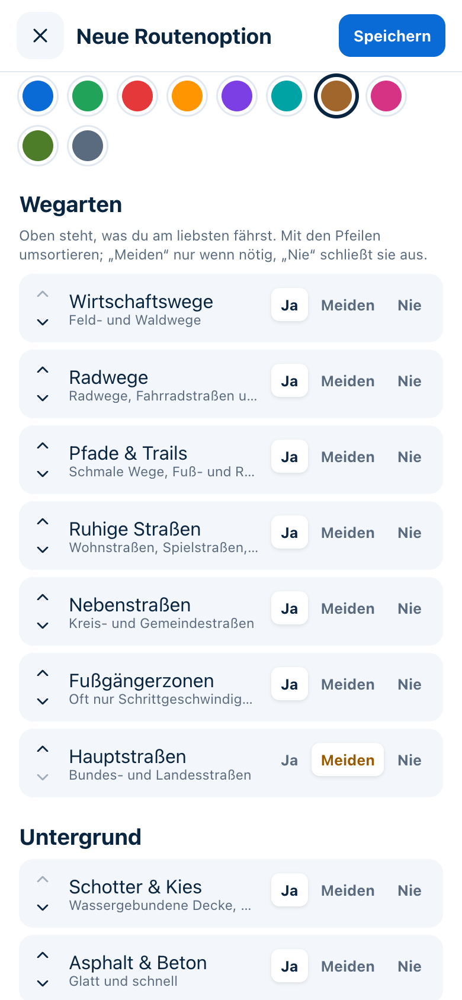

Unter **Profil → Eigene Routenoptionen → + Neue Routenoption** legst du fest, wie *deine* Routen aussehen sollen:

- **Vorlage** als Start: Ausgewogen, Rennrad, Gravel oder Familie
- **Wegarten** (Radwege, ruhige Straßen, Feldwege, Pfade, Hauptstraßen …) und **Untergründe** (Asphalt, Pflaster, Schotter, Naturboden …) nach Vorliebe sortieren – jeweils **Ja**, **Meiden** oder **Nie**
- **Steigungen:** Höhenmeter meiden, höchste Steigung und höchstes Gefälle
- Radrouten bevorzugen, Schieben, Treppen, Fähren, Tempo
- **Name, Kommentar, Symbol und Farbe**

Die eigene Option erscheint danach im Planer unter **Routenoption** → **Eigene**.

<br clear="right">

---

## Häufige Fragen

<details>
<summary><b>Der Standort wird nicht gefunden.</b></summary>

Erlaube den Standort für Bikepath bzw. für den Browser: Android unter *Einstellungen → Apps → Chrome → Berechtigungen → Standort*, iPhone unter *Einstellungen → Datenschutz & Sicherheit → Ortungsdienste → Safari-Websites*. Drinnen ist die Ortung oft ungenau – draußen wird es besser.
</details>

<details>
<summary><b>Warum dauert die Routenberechnung manchmal ein paar Sekunden?</b></summary>

Routen werden von einem freien, öffentlichen Routing-Dienst (BRouter) berechnet, den viele gleichzeitig nutzen. Rundtouren brauchen mehrere Anläufe und dauern etwas länger.
</details>

<details>
<summary><b>Ich sehe eine neue Funktion noch nicht.</b></summary>

Schließe die App einmal ganz (in der App-Übersicht wegwischen) und öffne sie neu. Ist gerade eine Planung offen oder läuft eine Fahrt, wartet das Update absichtlich, damit nichts verloren geht.
</details>

<details>
<summary><b>Werden meine Routen irgendwo hochgeladen?</b></summary>

Nein. Routen, Fahrten, Favoriten und Einstellungen liegen nur auf deinem Gerät. Zum Teilen gibt es den GPX-Export.
</details>

<details>
<summary><b>Gibt es Bewertungen wie bei Google?</b></summary>

Bikepath zeigt nur freie Daten aus OpenStreetMap und Wikipedia. Für Bewertungen gibt es in den Ortsinfos die Knöpfe zu Google Maps und Tripadvisor.
</details>

<details>
<summary><b>Kann ich die App weitergeben?</b></summary>

Ja – unter **Profil → App teilen** schickst du den Link per WhatsApp, Mail & Co.
</details>

---

## Daten und Datenschutz

- **Kein Konto, keine Werbung, kein Tracking, keine Cookies.**
- Deine Routen, Fahrten, Favoriten und Einstellungen bleiben **auf deinem Gerät**.
- Für Karten, Routen, Suche, Wetter und Ortsinfos fragt die App freie Dienste an. Diese erhalten dabei technisch bedingt deine IP-Adresse und die nötigen Angaben (z. B. Koordinaten einer Route):

| Wofür | Dienst |
|---|---|
| Karten und Orte | [OpenFreeMap](https://openfreemap.org) (Daten: [OpenStreetMap](https://www.openstreetmap.org/copyright)), optional CyclOSM, OpenTopoMap, Esri |
| Routenberechnung | [BRouter](https://brouter.de) |
| Suche | [Photon](https://photon.komoot.io) (komoot) |
| Ortsinfos | [Nominatim](https://nominatim.org), [Wikipedia](https://de.wikipedia.org), [Wikimedia Commons](https://commons.wikimedia.org) |
| Wetter | [Open-Meteo](https://open-meteo.com) |
| Höhen | Mapzen Terrain Tiles (AWS) |
| Bereitstellung der App | GitHub Pages |

Alle Quellen und Lizenzen stehen in der App unter **Profil → Rechtliches & Lizenzen**.
Kartendaten © [OpenStreetMap-Mitwirkende](https://www.openstreetmap.org/copyright).

---

<details>
<summary><b>Für Entwicklerinnen und Entwickler</b></summary>

Bikepath ist eine React-/TypeScript-PWA (Vite, MapLibre GL). Lokal starten:

```bash
npm install
npm run dev
```

| Dokument | Inhalt |
|---|---|
| [docs/ARCHITEKTUR.md](docs/ARCHITEKTUR.md) | Warum eine Web-App, Aufbau, bekannte Grenzen |
| [docs/ENTWICKLUNG.md](docs/ENTWICKLUNG.md) | Codeaufbau, häufige Änderungen, Konventionen, Fallstricke |
| [docs/TESTEN.md](docs/TESTEN.md) | Unit-Tests, Dienste live prüfen, Test auf dem Handy und im Browser |
| [docs/VEROEFFENTLICHEN.md](docs/VEROEFFENTLICHEN.md) | Veröffentlichung über GitHub Pages, Updates auf dem Handy |

Unter `.claude/skills/` liegen Anleitungen für Claude Code (Handytest, Browser-Test, Veröffentlichen, Routing-Profile).
</details>
